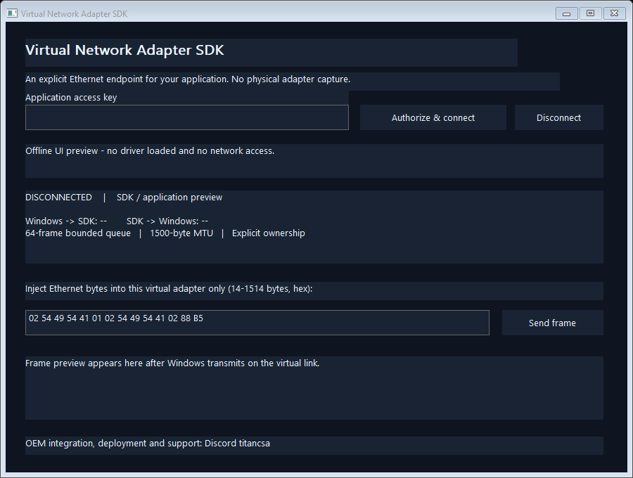

# Virtual Network Adapter SDK

**A Windows kernel virtual Ethernet adapter with a small C++ API for application-defined networking.**

<!-- full-version-contact:start -->
> [!IMPORTANT]
> **Full version and commercial licensing**
>
> **Discord username: `titancsa`**
>
> Open Discord, choose **Friends > Add Friend**, enter **`titancsa`**, then send a direct message. Mention **Virtual Network Adapter SDK** and ask about the **full / production version, commercial use or OEM redistribution**.
>
> Include your intended use and deployment size to discuss pricing, availability and the appropriate licensing / access instructions.
<!-- full-version-contact:end -->

Build a software network endpoint for protocol laboratories, network simulators, OEM connectivity tools and custom networking applications. Windows sends Ethernet frames to your application; your application supplies Ethernet frames back to Windows through the same virtual adapter.



**Microsoft-signed Windows x64 evaluation bundle.** Application 0.1.1 includes the verified Microsoft-signed NDIS driver 0.1.0.0, self-contained UI/console installers, native app, CLI, compact C++ SDK and example sources. No change to Windows signature-enforcement settings is required. Signing does not establish production qualification; see [validation](docs/VALIDATION.md).

## Use the adapter

1. Download the complete Windows x64 bundle from [Releases](https://github.com/titanfyre/Virtual-Network-Adapter-SDK/releases).
2. Extract the ZIP, run `NetworkAdapterSetup.exe` and select **Install / reinstall**. Administrator elevation is required. Restart only if Windows requests it.
3. Open `TitanVirtualNetwork.exe`, enter the application access key supplied for your evaluation or OEM integration and choose **Authorize & connect**.
4. The virtual link is now available to Windows. Inspect its counters and pass frames through your application. Closing the owning application disconnects the link.

The adapter starts disconnected. Installation and the example application leave physical network adapters, DNS, gateways and bridges unchanged. Assign addressing and implement your application protocol for your own deployment. The UI refreshes counters every 200 ms; this display interval does not rate-limit the driver data path.

The console tool supports `NetworkAdapterCLI.exe status` and `NetworkAdapterCLI.exe connect`. Uninstall with the UI or `NetworkAdapterSetupConsole.exe /uninstall`. Console installation uses `/install`; exit code `3010` means Windows requires a restart. Both setup executables embed the driver package and verify its exact identity, trusted Microsoft-root hardware-publisher catalog and INF/SYS catalog membership before installation.

## Minimal C++ integration

Keep the complete `SDK/` directory (including its protocol headers), compile `SDK/NetworkAdapter.cpp` with your application and link `setupapi.lib`, `winhttp.lib` and `crypt32.lib`.

```cpp
#include "SDK/NetworkAdapter.h"

NetworkAdapter adapter; // Keep alive while connected.
auto error = adapter.Authorize(accessKey); // English error string; empty on success.
if (!error.empty()) return;
if (adapter.Connect() != ERROR_SUCCESS) return;

VN_FRAME frame{};
if (adapter.Receive(frame) == ERROR_SUCCESS) {
    // frame.data[0 .. frame.length) is a complete Ethernet frame from Windows.
}

// std::vector<unsigned char> ethernetBytes = ...;
// adapter.Send(ethernetBytes); // Supply an Ethernet frame to Windows.
```

`Receive()` removes one queued frame. `ERROR_NO_MORE_ITEMS` means the queue is empty. An application should wait or schedule its next read rather than busy-polling. `Send()` derives the byte count from the vector and returns a Windows error code. `Query()` returns connection/running state, MAC address, queue usage and counters. `Disconnect()` is explicit; destruction closes the driver handle and releases its connection automatically. Serialize calls on one `NetworkAdapter` object if you use multiple threads.

After device removal or restart, stale-handle errors close the SDK's handle. The next call opens the current endpoint; authorize and connect again before exchanging frames. A failed frame send is returned to the application without an automatic resend.

The first evaluation supports one Ethernet adapter with MAC `02:54:49:54:41:01`, a 1500-byte MTU, complete 14-1514-byte frames and a 64-frame bounded outbound queue. Queue saturation drops new frames and increments the drop counter. It provides no timing or throughput guarantee. The reported 1 Gbit/s link speed is an advertised software link property, not a benchmark.

## Authorization and distribution

The administrator issues a product-specific evaluation or commercial access key. `Authorize()` obtains a fresh challenge from this driver's open handle, requests a signed permission over HTTPS and submits the permission to the driver. The kernel verifies the P-256 signature, product, nonce and bounded lifetime. The signing private key stays on the server; editing the public SDK cannot mint a permission. A permission lasts at most one hour and must be renewed explicitly. Network access is needed to authorize or renew, not for each frame.

Packet access stops as soon as the permission expires. The next passive control operation disconnects the link and clears its queued frames before renewal; an idle link's Windows disconnect notification is deferred until that operation. Reauthorize and reconnect explicitly to continue.

Keys can be revoked in the common administration portal; revocation prevents new permissions after already-issued permissions expire. Keys are bearer credentials: recipients can share them, and this version does not bind a key to a machine or enforce a per-machine seat limit. A local administrator, compromised kernel or an authorized application acting as a relay remains outside any promise of unbreakable licensing. Applications should protect their access keys and handle renewal failures explicitly.

For an evaluation, an OEM redistribution agreement, application integration or deployment support, add **`titancsa` on Discord**. Send your Windows versions, expected deployment count and intended Ethernet protocol. Public application/SDK source is MIT; the private driver has separate evaluation/OEM distribution terms. Availability of a Microsoft signature does not establish WHQL certification or Microsoft endorsement.

## Build and validation

Windows x64, Visual Studio 2022 C++ desktop tools, CMake 3.20+ and the Windows SDK:

```powershell
.\Build.ps1
.\Build.ps1 -Asan
# Optional: embed a separately received opaque Microsoft-signed package.
.\Build.ps1 -DriverPackageDirectory C:\Signed\TitanVirtualNetwork
```

Outputs are in `obj/Build/bin/Release`. Without an opaque signed driver package, compiled setup tools contain no installable driver payload. An authorized packager can set `-DDRIVER_PACKAGE_DIRECTORY="C:/Signed/TitanVirtualNetwork"` when configuring CMake to embed the matching INF/CAT/SYS files. Setup retains its signature and membership checks.

The native application/SDK and installer sources compile with MSVC `/W4 /WX`, CFG and a static runtime. The frame parser passes 40,014 bounded-input and deterministic randomized assertions. Twelve installer identity/signature-refusal checks pass; both CTest cases also pass under AddressSanitizer. Seventeen additional read-only checks accept the returned Microsoft catalog and exact INF/SYS members, then reject altered files. Embedded installer resources exactly match the signed return. The complete signed console installation/runtime/removal campaign passes on Windows 10 build 19045 x64, normally and under targeted Driver Verifier, with test-signing disabled. It includes real Windows UDP delivery, 1,024 receive indications, live-owner removal/replacement and stale-generation rejection. See [validation](docs/VALIDATION.md) for the evidence and remaining deployment limits. The private kernel source is not included in the public repository.

## Architecture and scope

The driver is an original software-only **NDIS 6.30 miniport**, using documented Windows interfaces. It exposes an independent virtual Ethernet interface and a versioned administrator-only control endpoint. Packet exchange is restricted to the application's own virtual adapter and requires one authorized owner. Buffers are bounded, user input is copied through buffered IOCTLs, and pause/removal drain active data-path operations before freeing resources.

Existing alternatives include [Wintun](https://www.wintun.net/) for layer-3 packet interfaces and [OpenVPN TAP-Windows](https://github.com/OpenVPN/tap-windows6) for Ethernet interfaces. This project's offer is a compact SDK, explicit ownership, product-key administration and scoped OEM integration/support. Its initial feature set covers one fixed virtual interface; multi-adapter management, shared-memory rings, route configuration, tunnelling transports and extended deployment qualification require further implementation and testing.

Technical references: [NDIS miniport drivers](https://learn.microsoft.com/en-us/windows-hardware/drivers/network/ndis-miniport-drivers2), [virtual NIC models](https://learn.microsoft.com/en-us/windows-hardware/drivers/network/network-interface-card-support), [pausing an adapter](https://learn.microsoft.com/en-us/windows-hardware/drivers/network/pausing-an-adapter) and [mandatory miniport OIDs](https://learn.microsoft.com/en-us/windows-hardware/drivers/network/mandatory-oids-for-miniport-drivers).

## Responsible use

Use only on systems you own or administer with authorization, and comply with applicable law and third-party terms. The software is intended for legitimate integration, testing and network application development. To the extent permitted by law, the author is not responsible for misuse, unlawful activity or resulting damage. It is supplied without warranty; mandatory statutory rights remain unaffected. See [MIT license](LICENSE) for public source terms and the accompanying separate terms for driver binaries.
